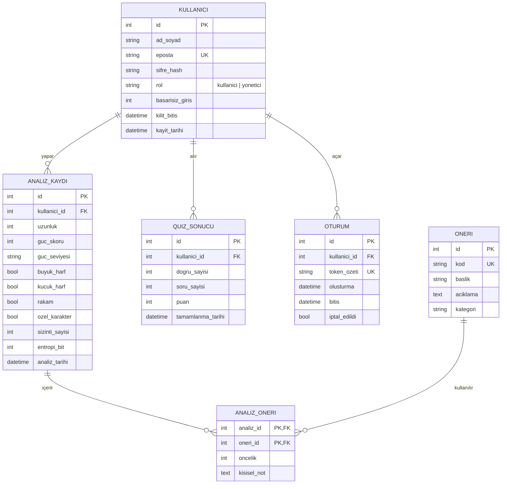

# ER Diyagramı (Varlık–İlişki Modeli)

## Varlıklar

| Varlık | Açıklama | Birincil anahtar |
|---|---|---|
| **Kullanıcı** | Siteye kayıtlı kişi | `id` |
| **Analiz Kaydı** | Bir parola analizinin sonucu (parolanın kendisi değil, ölçümleri) | `id` |
| **Öneri** | Tekrar kullanılabilir öneri kataloğu (ör. "Parolayı 12+ karakter yap") | `id` |
| **Analiz–Öneri** | Bir analize hangi önerilerin verildiğini tutan ara tablo | (`analiz_id`, `oneri_id`) bileşik |
| **Quiz Sonucu** | Kullanıcının farkındalık quizindeki puanı | `id` |
| **Oturum** | Giriş yapan kullanıcının oturumu; token'ın yalnızca özeti saklanır (Hafta 5) | `id` |

## İlişkiler

| İlişki | Tür | Açıklama |
|---|---|---|
| Kullanıcı → Analiz Kaydı | **1-N** | Bir kullanıcı çok sayıda analiz yapabilir; her analiz tek kullanıcıya aittir. |
| Kullanıcı → Quiz Sonucu | **1-N** | Bir kullanıcı quizi birden çok kez çözebilir. |
| Kullanıcı → Oturum | **1-N** | Bir kullanıcı farklı cihazlardan birden çok oturum açabilir. |
| Analiz Kaydı ↔ Öneri | **N-N** | Bir analize birden çok öneri verilir; aynı öneri birçok analizde kullanılır. `analiz_oneri` ara tablosuyla çözülür. |

> **1-1 örneği (projede kullanılmadı):** İleride her kullanıcıya tek bir "Güvenlik Profili" (2FA açık mı, son rapor tarihi vb.) eklenirse Kullanıcı ↔ Profil ilişkisi 1-1 olur.

## Normalizasyon

- **1NF:** Her sütun tek (atomik) değer tutar. Karakter türleri tek bir metin alanına ("ABc1!") yazılmadı; `buyuk_harf`, `kucuk_harf`, `rakam`, `ozel_karakter` ayrı sütunlardır. Öneriler bir analiz satırına virgüllerle yazılmadı; ara tabloya taşındı.
- **2NF:** Bileşik anahtarlı tek tablo `analiz_oneri`'dir; `oncelik` ve `kisisel_not` anahtarın tamamına (analiz + öneri) bağlıdır. Öneri başlığı/açıklaması yalnızca `oneri_id`'ye bağlı olduğundan `oneri` tablosuna ayrıldı.
- **3NF:** Kullanıcı bilgileri (ad, e-posta) analiz veya quiz tablolarında tekrar edilmez; yalnızca `kullanici_id` yabancı anahtarı tutulur.

> Tabloların SQL karşılığı, kısıtlar ve indeksler: [veritabani.md](veritabani.md) · `backend/app/veri/migrations/001_ilk_sema.sql`

## Güvenlik kararı

Analiz edilen parola **veya hash'i veritabanına yazılmaz**. Sızıntı kontrolü HIBP'nin k-anonimlik yöntemiyle yapılır (SHA-1 özetinin yalnızca ilk 5 karakteri gönderilir); sonuçtan sadece `sizinti_sayisi` saklanır. `kullanici.sifre_hash` ise siteye giriş parolasıdır ve tuzlu hash ile saklanır.
