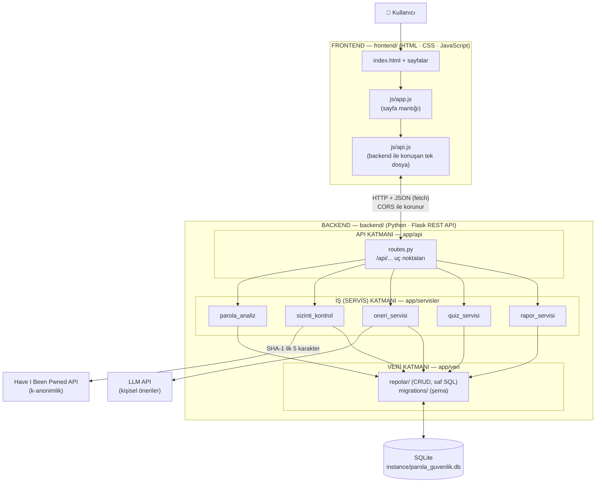

# Mimari Şema — Frontend / Backend Ayrımı ve Katmanlı Mimari

Proje iki bağımsız parçadan oluşur:

- **Frontend** (`frontend/`): Tarayıcıda çalışan HTML, CSS ve JavaScript. Kullanıcının gördüğü web sitesi.
- **Backend** (`backend/`): Python/Flask ile yazılmış REST API. Frontend'e yalnızca **JSON** döndürür. Kendi içinde üç katmana ayrılır (API / İş / Veri).

## Parçaların ve katmanların görevi

| Parça / Katman | Klasör | Ne yapar | Ne yapmaz |
|---|---|---|---|
| **Frontend** | `frontend/` | Sayfaları gösterir, kullanıcıdan veri alır, API'yi çağırır | Veritabanına erişmez, güvenlik kararı vermez |
| **API katmanı** | `backend/app/api/` | URL'leri karşılar, isteği doğrular, JSON döndürür | Hesap yapmaz |
| **İş (Servis) katmanı** | `backend/app/servisler/` | Parola skoru, sızıntı kontrolü, öneri, quiz puanı | HTTP / HTML bilmez |
| **Veri katmanı** | `backend/app/veri/` | Tabloları tanımlar, kayıt okur/yazar | İş kuralı içermez |

**Kural:** Bağımlılık yalnızca bir yönde akar: Frontend → API → İş → Veri. Frontend veritabanını hiç görmez.

## API uç noktaları

| Yöntem | Adres | Yanıt |
|---|---|---|
| GET | `/api/saglik` | `{"durum": "calisiyor", "veritabani": "bagli", "surum": "0.8.0"}` |
| GET | `/api/moduller` | Sitedeki modüllerin listesi |
| GET | `/api/oneriler` | Veritabanındaki öneri kataloğu (Hafta 4) |
| POST | `/api/kayit` | Yeni hesap (rol her zaman `kullanici`) |
| POST | `/api/giris` | Token + kullanıcı bilgisi |
| POST | `/api/cikis` | 🔒 Oturumu sunucuda iptal eder |
| GET | `/api/ben` | 🔒 Giriş yapan kullanıcı ve özet bilgileri |
| GET | `/api/yonetici/kullanicilar` | 🔒👑 Tüm kullanıcılar |
| PATCH | `/api/yonetici/kullanicilar/<id>/rol` | 🔒👑 Rol değiştirir |
| POST | `/api/analiz` | Parola gücü analizi (`kaydet: true` için 🔒) |
| GET | `/api/analizler` | 🔒 Kendi analiz geçmişi |
| GET | `/api/analizler/<id>` | 🔒 Kendi analizi + önerileri (başkasınınki 404) |
| DELETE | `/api/analizler/<id>` | 🔒 Kendi analizini siler (başkasınınki 404) |
| GET | `/api/rehber` | Rehber konuları (Hafta 7) |
| GET | `/api/rehber/<slug>` | Konu içeriği, önceki/sonraki konu, bağlı öneriler |
| POST | `/api/quiz/baslat` | 🔒 Yeni quiz (açık deneme varsa onu döndürür) |
| GET | `/api/quiz/<id>` | 🔒 Açık denemenin soruları veya bitmiş denemenin sonucu (başkasınınki 404) |
| POST | `/api/quiz/<id>/gonder` | 🔒 Cevapları gönderir; puan sunucuda hesaplanır |
| GET | `/api/quiz/gecmis` | 🔒 Kendi quiz sonuçları |

🔒 giriş gerekli (`Authorization: Bearer <token>`, yoksa `401`) · 👑 yalnızca yönetici (değilse `403`)

## Modüller arası veri akışı (Hafta 8: "Hangi modül hangi veriyi nereden alıyor?")

| Modül | Okuduğu veri | Yazdığı veri | Bağlı olduğu modül |
|---|---|---|---|
| Kimlik (H5) | `kullanici`, `oturum` | `kullanici`, `oturum` | Diğer tüm modüller `@giris_gerekli` ile bunu kullanır |
| Parola Analizi (H6) | `oneri` (katalog), oturumdaki kullanıcının adı ve e-postası | `analiz_kaydi`, `analiz_oneri` | Kimlik (kişisel bilgi kuralı, kayıt sahibi), Rehber (öneri → konu) |
| Rehber (H7) | `rehber_konu`, `oneri` | — | Analiz önerileri buraya bağlanır |
| Quiz (H7) | `quiz_soru`, `quiz_secenek`, `rehber_konu` | `quiz_deneme`, `quiz_deneme_soru`, `quiz_sonucu` | Kimlik (sahiplik), Rehber (yanlış cevap → konu) |
| Panel (H5→H7) | `kullanici`, `analiz_kaydi`, `quiz_sonucu` | — | Analiz ve quiz modüllerinin özetini gösterir |
| Yönetici (H5) | `kullanici` | `kullanici.rol`, `oturum` (iptal) | Kimlik |

## Canlı sürüm: tek adres

Canlıda (Render) Flask, API'nin yanında `frontend/` klasörünü de sunar: `/` → `index.html`, `/quiz.html`, `/js/...`. `/api/...` istekleri her zaman API'ye gider. Böylece hoca tek bir link açar ve CORS gerekmez. Yerelde frontend ayrı sunucudan da (`:8000`) açılabilir; `config.js` hangisi olduğunu algılar. Ayrıntılar: [yayinlama.md](yayinlama.md).

## Neden frontend ve backend ayrıldı?

- **Bağımsız geliştirme:** Arayüz değişse de backend aynen kalır; ileride bir mobil uygulama aynı API'yi kullanabilir.
- **Güvenlik:** Veritabanı ve API anahtarları yalnızca backend'de durur, tarayıcıya hiç gitmez. CORS ayarı sadece izin verilen frontend adresinin API'yi çağırmasına izin verir.
- **Esnek yayınlama:** Frontend istenirse ayrı bir statik sunucudan (ör. GitHub Pages) yayınlanabilir. Bu projede kolaylık için backend tarafından aynı adresten sunuluyor; kod yine iki ayrı klasörde ve birbirinden bağımsız.

## Neden backend içinde katmanlı mimari?

- **Sorumlulukların ayrılması:** Her dosyanın tek bir işi vardır; hata bulmak kolaylaşır.
- **Test edilebilirlik:** Parola analizi gibi iş kuralları web isteği olmadan tek başına test edilebilir.
- **Proje ölçeğine uygunluk:** Mikroservis gibi daha karmaşık yapılar bu boyutta bir proje için gereksiz yük getirir.
