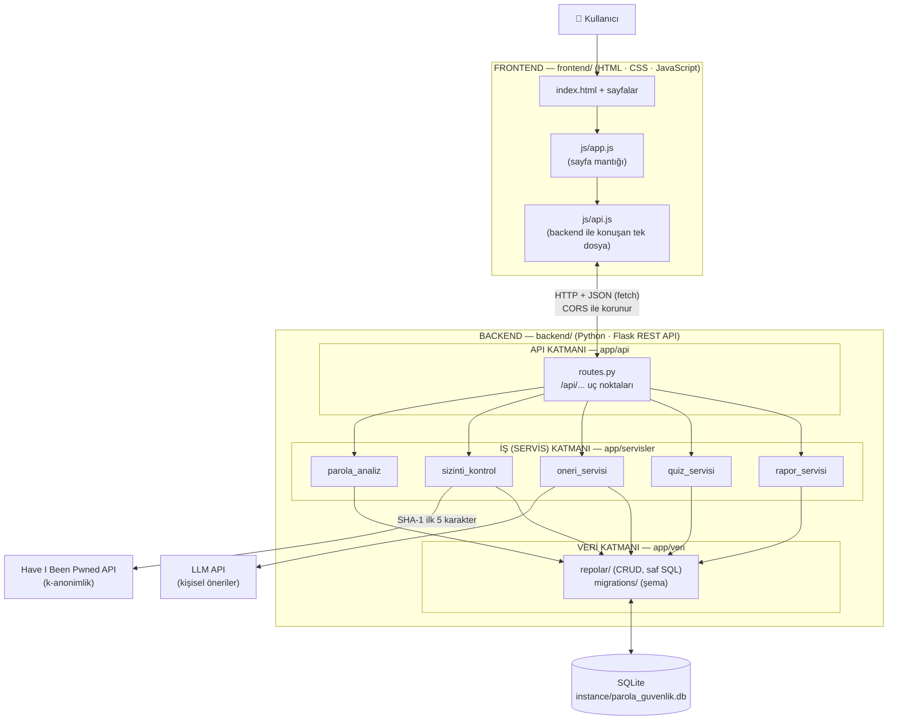

# Mimari Şema — Frontend / Backend Ayrımı ve Katmanlı Mimari

Proje iki bağımsız parçadan oluşur:

- **Frontend** (`frontend/`): Tarayıcıda çalışan HTML, CSS ve JavaScript. Kullanıcının gördüğü web sitesi.
- **Backend** (`backend/`): Python/Flask ile yazılmış REST API. Frontend'e yalnızca **JSON** döndürür. Kendi içinde üç katmana ayrılır (API / İş / Veri).

## Parçaların ve katmanların görevi

| Parça / Katman | Klasör | Ne yapar | Ne yapmaz |
|---|---|---|---|
| **Frontend** | `frontend/` | Sayfaları gösterir, kullanıcıdan veri alır, API'yi çağırır | Veritabanına erişmez, güvenlik kararı vermez |
| **API katmanı** | `backend/app/api/` | URL'leri karşılar, isteği doğrular, JSON döndürür | Hesap yapmaz |
| **İş (Servis) katmanı** | `backend/app/servisler/` | Parola skoru, sızıntı kontrolü, öneri, quiz puanı | HTTP / HTML bilmez |
| **Veri katmanı** | `backend/app/veri/` | Tabloları tanımlar, kayıt okur/yazar | İş kuralı içermez |

**Kural:** Bağımlılık yalnızca bir yönde akar: Frontend → API → İş → Veri. Frontend veritabanını hiç görmez.

## API uç noktaları

| Yöntem | Adres | Yanıt |
|---|---|---|
| GET | `/api/saglik` | `{"durum": "calisiyor", "veritabani": "bagli"}` |
| GET | `/api/moduller` | Sitedeki modüllerin listesi |
| GET | `/api/oneriler` | Veritabanındaki öneri kataloğu (Hafta 4) |

## Neden frontend ve backend ayrıldı?

- **Bağımsız geliştirme:** Arayüz değişse de backend aynen kalır; ileride bir mobil uygulama aynı API'yi kullanabilir.
- **Güvenlik:** Veritabanı ve API anahtarları yalnızca backend'de durur, tarayıcıya hiç gitmez. CORS ayarı sadece izin verilen frontend adresinin API'yi çağırmasına izin verir.
- **Ayrı yayınlama:** Frontend statik dosya olarak (ör. GitHub Pages), backend ayrı bir sunucuda yayınlanabilir.

## Neden backend içinde katmanlı mimari?

- **Sorumlulukların ayrılması:** Her dosyanın tek bir işi vardır; hata bulmak kolaylaşır.
- **Test edilebilirlik:** Parola analizi gibi iş kuralları web isteği olmadan tek başına test edilebilir.
- **Proje ölçeğine uygunluk:** Mikroservis gibi daha karmaşık yapılar bu boyutta bir proje için gereksiz yük getirir.
