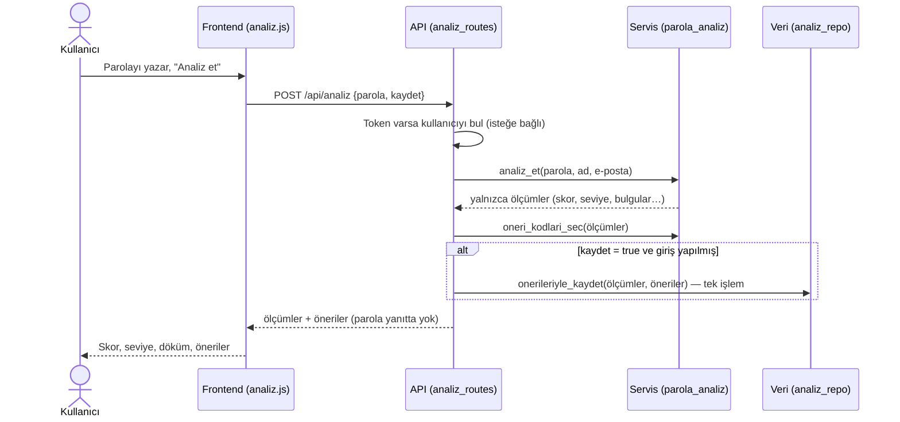
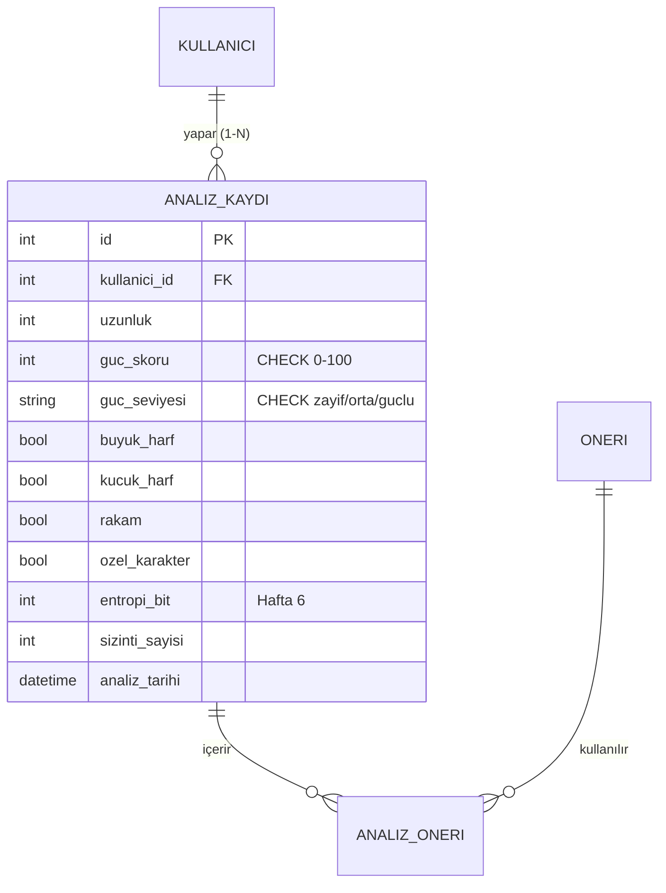

# Çekirdek Modül A: Parola Gücü Analizi (Hafta 6)

Kullanıcının girdiği parolanın gücünü ölçen, skor, seviye ve tahmini kırılma süresi üreten ve öneriler sunan modül. **Parola hiçbir yerde saklanmaz.**

## İlgili kod

| Katman | Dosya | Görevi |
|---|---|---|
| İş (servis) | `backend/app/servisler/parola_analiz.py` | Ölçütler, desenler, iş kuralları, skor, öneri seçimi |
| API | `backend/app/api/analiz_routes.py` | `/api/analiz`, `/api/analizler`, sahiplik kontrolü |
| Veri | `backend/app/veri/repolar/analiz_repo.py` | Analizi ve önerilerini tek işlemde kaydetme |
| Veri | `backend/app/veri/migrations/004_parola_analizi.sql` | `entropi_bit` sütunu, 3 yeni öneri |
| Frontend | `frontend/analiz.html`, `frontend/js/analiz.js` | Analiz formu, sonuç, skor dökümü, geçmiş |
| Test | `backend/tests/test_parola_analiz.py` | 40 test (iş kuralları + API + sahiplik) |

## Akış

## 1. Güç hangi ölçütlerle hesaplanıyor?

**Skor (0–100) = Uzunluk + Çeşitlilik + Benzersizlik − Cezalar**, ardından iş kurallarındaki üst sınırlar uygulanır.

| Ölçüt | Puan | Gerekçe |
|---|---|---|
| **Uzunluk** | karakter başına 2,5 → en fazla **40** (16+ karakter) | Gücü en çok artıran etken uzunluktur. |
| **Çeşitlilik** | küçük harf, büyük harf, rakam, özel karakter; her biri 10 → en fazla **40** | Karakter havuzunu büyütür. 20+ karakterli parola cümlelerinde en az 30 sayılır. |
| **Benzersizlik** | farklı karakter sayısı ÷ uzunluk × 20 → en fazla **20** | "aaaaaaaa" gibi uzun ama tekdüze parolaları ayırt eder. |

### Desen cezaları

| Desen | Ceza | Örnek |
|---|---|---|
| Yaygın bir kelime içeriyor | −30 | `Mavi.Ankara!7z` |
| Kişisel bilgi (giriş yapan kullanıcının adı/e-postası) | −30 | `Nehir2003!` |
| Klavye deseni | −15 | `asdf`, `qwer` |
| Yalnızca rakam | −15 | `83920174650912` |
| Ardışık dizi | −10 | `abc`, `123`, `cba` |
| Aynı karakter 3+ kez art arda | −10 | `aaa`, `111` |
| Yıl/tarih | −10 | `1998`, `2024` |

Karşılaştırmadan önce parola sadeleştirilir: Türkçe karakterler (`Şifre` → `sifre`) ve harf yerine kullanılan semboller (`P@ssw0rd` → `password`) dönüştürülür. Böylece bilinen hileler de yakalanır.

### Seviye

| Skor | Seviye |
|---|---|
| 0–39 | Zayıf |
| 40–69 | Orta |
| 70–100 | Güçlü |

### Ek ölçümler

- **Entropi (bit)** = uzunluk × log₂(karakter havuzu). Bu bir kaba kuvvet tahminidir ve desenleri hesaba katmaz.
- **Tahmini kırılma süresi**, saniyede 10 milyar tahmin yapan bir saldırgan varsayımıyla hesaplanır. Burada desenler hesaba katılır ("etkin entropi"): sözlük kelimesi tek bir tahmin sayılır, tekrar eden karakterler bir kez sayılır ve diğer her desen 12 bit düşürür. Bu yüzden `Galatasaray1905` 89 bit entropiye sahip olsa da "anında" kırılır.

## 2. Parola saklanıyor mu? Hayır.

| Nerede? | Ne oluyor? |
|---|---|
| Tarayıcı | Parola yalnızca form alanındadır; `localStorage`, `sessionStorage` veya çerezlere yazılmaz. Alan `autocomplete="off"`. |
| Ağ | Yalnızca `POST /api/analiz` isteğinin gövdesinde gider (tarayıcı testinde doğrulandı). Yayında HTTPS zorunludur. |
| Backend | Bellekte analiz edilir. Servis yalnızca ölçümleri döndürür; yanıt parolayı geri göndermez. Parola loglanmaz. |
| Veritabanı | Yalnızca uzunluk, skor, seviye, karakter türleri, entropi ve öneriler saklanır. Parolanın kendisi de hash'i de yoktur. |
| Harici servis | Yoktur: analiz tamamen yerel yapılır. |

Testler bunu kanıtlar: `test_parola_veritabaninin_hicbir_yerinde_yok` testi tüm veritabanını döküp parolayı arar, `test_yanit_parolayi_geri_gondermez` testi de yanıtı kontrol eder.

> Neden hash'i de saklamıyoruz? Hash'lenmiş bir parola bile çevrimdışı kaba kuvvet saldırısıyla kırılabilir. Analiz için parolaya tekrar ihtiyaç yoktur; bu yüzden en güvenli yol hiç saklamamaktır (veri minimizasyonu, KVKK).

## 3. Modülün verisi nasıl modellendi?

Hafta 3–4'teki modele ekleme yapıldı. Yeni tablo gerekmedi; değişiklik yeni bir migration dosyasıyla (`004`) eklendi.

- **Bulgular nerede?** Desenler ayrı bir metin sütununa ("klavye,yil" gibi) yazılmadı, çünkü bu 1NF'yi bozardı. Her bulgu bir öneriye karşılık gelir ve **`analiz_oneri` ara tablosuna** öncelik sırasıyla kaydedilir (N-N).
- 3 yeni öneri eklendi: `YAYGIN_PAROLA`, `KISISEL_BILGI`, `DESEN_KACIN`.
- Kişisel olmayan analizler (giriş yapılmadan) **hiç kaydedilmez**.

## 4. Hangi iş kuralları konuldu ve neden?

| Kural | Neden |
|---|---|
| Birebir yaygın parola → skor en fazla **5** | Saldırganlar ilk önce bu listeyi dener; uzunluğu ne olursa olsun anında kırılır. |
| Yaygın parola + yalnızca rakam/sembol (`Galatasaray1905`) → en fazla **15** | "Kelime + yıl" en çok denenen kalıplardandır. |
| 5'ten az farklı karakter → en fazla **30** | `aaaaaaaaaaaaaaaa` uzun olduğu için yüksek puan almamalı. |
| 8 karakterden kısa → en fazla **30** (her zaman zayıf) | Kısa parolalar çeşitli olsa bile kaba kuvvetle hızla kırılır. |
| 12 karakterden kısa → en fazla **69** ("güçlü" olamaz) | Güncel öneriler (NIST, OWASP) en az 12 karakteri işaret eder. |
| 20+ karakterde çeşitlilik en az 30 sayılır | Parola cümleleri (`correct horse battery staple`) uzunluk sayesinde güçlüdür. |
| Skor her zaman 0–100 arasında; seviye her zaman skora uygun | Rastgele 500 parolayla test edildi. |

### Doğrulama (girdi kuralları)

| Kural | Sonuç |
|---|---|
| Parola boş | `400` "Analiz için bir parola girin." |
| Metin değil (sayı, null) | `400` |
| 128 karakterden uzun | `400` (aşırı uzun girdiyle sunucuyu yorma girişimi engellenir) |
| "Kaydet" denildi ama giriş yok | `401` |

### Erişim ve sahiplik kontrolü

- `GET /api/analizler` yalnızca **kendi** analizlerini döndürür.
- `GET` ve `DELETE /api/analizler/<id>` istekleri, kayıt başkasına aitse **404** döner. 403 yerine 404 dönülmesinin sebebi, başka kullanıcıların kayıtlarının var olup olmadığının bile anlaşılmamasıdır. Sahiplik kontrolü SQL sorgusunun içindedir: `WHERE id = ? AND kullanici_id = ?`.

### İlişkili kayıtların yönetimi

- Analiz ve önerileri **tek bir işlemde** (transaction) kaydedilir: `with con:` bloğu ya hepsini kaydeder ya hiçbirini. Yarım kayıt kalmaz.
- Analiz silinince önerileri `ON DELETE CASCADE` ile silinir. Kullanıcı silinince analizleri de silinir.

## 5. Modül diğer modüllerle nasıl entegre edildi?

| Modül | Entegrasyon |
|---|---|
| **Kimlik doğrulama (Hafta 5)** | Token varsa kullanıcı tanınır, "kaydet" açılır ve adı/e-postası kişisel bilgi kontrolünde kullanılır. Geçmiş uç noktaları `@giris_gerekli` ile korunur. |
| **Kullanıcı paneli (Hafta 5)** | Kaydedilen analiz paneldeki "Son analizlerim" listesinde görünür (`test_panel_kaydedilen_analizi_gosterir`). Panelden "Yeni analiz yap" bağlantısı var. |
| **Veri katmanı (Hafta 4)** | Mevcut `analiz_kaydi`, `oneri`, `analiz_oneri` tabloları kullanıldı; değişiklik yeni migration ile yapıldı. |
| **Örnek veri** | `ornek_veri.py` artık seviye, entropi ve öneri seçimi için bu modülün fonksiyonlarını kullanıyor. Kurallar tek yerde tanımlı. |
| **Ana sayfa** | "Parola Gücü Analizi" kartı "Hazır" olarak işaretlendi ve tıklanabilir oldu. |
| **Sonraki haftalar** | Sızıntı kontrolü `sizinti_sayisi` alanını dolduracak; `SIZINTI_DEGISTIR` önerisi o zaman otomatik devreye girecek. |

## Örnek sonuçlar

| Parola | Skor | Seviye | Kırılma süresi | Bulgular |
|---|---|---|---|---|
| `123456` | 5 | Zayıf | anında | yaygın parola, ardışık, yalnızca rakam |
| `P@ssw0rd` | 5 | Zayıf | anında | yaygın parola (sembol hilesi yakalandı) |
| `Galatasaray1905` | 15 | Zayıf | anında | yaygın parola türevi, yıl |
| `aaaaaaaaaaaaaaaa` | 30 | Zayıf | 1 saniyeden az | tekrar |
| `Ankara06!Deniz` | 62 | Orta | yaklaşık 15 yıl | yaygın kelime |
| `correct horse battery staple` | 79 | Güçlü | binlerce yıldan fazla | – |
| `kedi-mavi-bulut-74` | 86 | Güçlü | binlerce yıldan fazla | – |
| `Tr!7kq#Lm2@vZ9xW` | 100 | Güçlü | binlerce yıldan fazla | – |

## Yapay zekâ kullanımı

Yapay zekâ; skor modeli için alternatifler (yalnızca entropi, zxcvbn tarzı desen tabanlı model), sınır durumları için test örnekleri ve kod düzenleme önerileri almak amacıyla kullanıldı. Ölçütlerin ağırlıkları, iş kuralları ve eşik değerleri örnek parolalarla denenip proje ihtiyacına göre belirlendi.
