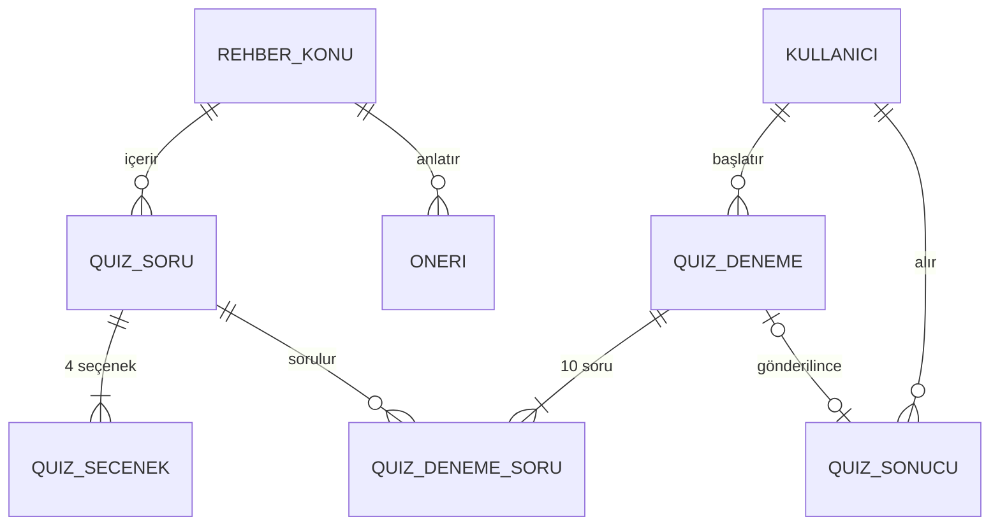
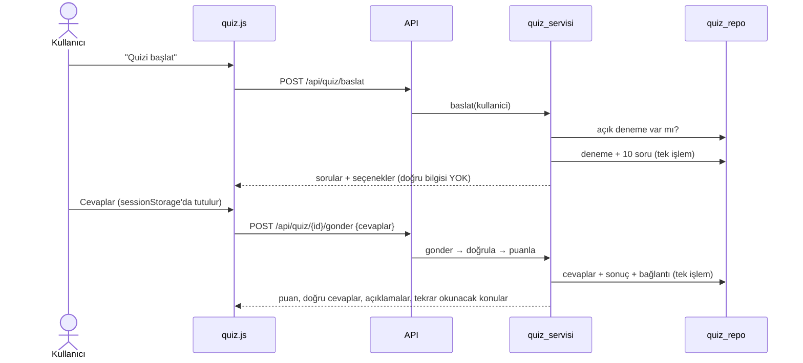

# Çekirdek Modül B: Farkındalık Rehberi ve Quiz (Hafta 7)

Kullanıcıya parola güvenliğinin temel konularını anlatan bir **rehber** (7 konu) ve bu konulardan soru soran, sonucu puanlayıp yanlış yapılan konulara yönlendiren bir **quiz** (21 soruluk bankadan 10 soru).

## İlgili kod

| Katman | Dosya | Görevi |
|---|---|---|
| Veri | `backend/app/veri/migrations/005_rehber_quiz.sql` | 5 yeni tablo, kısıtlar, indeksler, öneri → rehber bağı |
| Veri | `backend/app/veri/migrations/006_rehber_icerigi.sql` | 7 konu, 21 soru, 84 seçenek |
| Veri | `backend/app/veri/repolar/rehber_repo.py`, `quiz_repo.py` | Okuma, deneme oluşturma ve tamamlama (tek işlem) |
| İş (servis) | `backend/app/servisler/quiz_servisi.py` | Soru seçimi, cevap doğrulama, puanlama, geri bildirim |
| API | `backend/app/api/rehber_quiz_routes.py` | `/api/rehber`, `/api/quiz/...` |
| Frontend | `frontend/rehber.html`, `frontend/quiz.html`, `frontend/js/quiz.js` | Konu listesi ve sayfası; quiz ekranları |
| Test | `backend/tests/test_rehber_quiz.py` | 33 test (içerik, kısıtlar, akış, doğrulama, sahiplik) |

## Veri modeli

| Tablo | Neden var? |
|---|---|
| `rehber_konu` | Rehber içeriği. `slug` adreslerde kullanılır (`rehber.html?konu=oltalama`). |
| `quiz_soru` | Soru bankası. Her soru bir konuya bağlıdır; yanlış cevapta o konu önerilir. |
| `quiz_secenek` | Seçenekler. **Kısmi benzersiz indeks** (`WHERE dogru = 1`) ile bir sorunun en fazla bir doğru cevabı olabilir. |
| `quiz_deneme` | Başlatılmış quiz. `son_teslim` süre sınırını, `sonuc_id` gönderilip gönderilmediğini tutar. |
| `quiz_deneme_soru` | Denemede hangi soruların hangi sırayla sorulduğu ve verilen cevaplar (N-N ara tablo). |
| `quiz_sonucu` | Hafta 3'te tasarlanan sonuç tablosu; panel ve rapor buradan okur. |

**Neden deneme ve sonuç ayrı?** Quiz başlarken sonuç henüz yoktur (puan `NOT NULL`). Deneme "devam eden quiz"i, sonuç ise "bitmiş quiz"in özetini tutar. Gönderilince ikisi `sonuc_id` ile bağlanır. Böylece Hafta 4'teki `quiz_sonucu` tablosu ve kısıtları değişmeden kaldı.

## İş kuralları

| # | Kural | Neden | Nerede |
|---|---|---|---|
| 1 | Quiz için giriş gerekir; rehber herkese açık | Sonuç kullanıcıya kaydedilir; bilgi ise herkes için | `@giris_gerekli` |
| 2 | Her denemede 10 soru: önce her konudan 1, kalanı rastgele | Her quiz tüm konuları kapsasın | `quiz_servisi.soru_sec` |
| 3 | Doğru cevaplar gönderimden önce tarayıcıya gitmez | Sayfa kodu incelenerek kopya çekilemesin | `_deneme_json` (`dogru` alanı çıkarılır) |
| 4 | Aynı anda tek açık deneme; tekrar "başlat" mevcut denemeyi döndürür | Sınırsız deneme açıp soru toplanmasın | `quiz_repo.acik_deneme` |
| 5 | 30 dakika süre; süre dolunca `410` | Sınav mantığı; terk edilmiş denemeler kapanır | `son_teslim` sütunu |
| 6 | Tüm sorular cevaplanmalı; seçenek kendi sorusuna ait olmalı; denemede olmayan soru gönderilemez | Bozuk veya sahte istek puanı etkilemesin | `_cevaplari_dogrula` |
| 7 | Deneme bir kez gönderilir (`409`) | Puan sonradan değiştirilemesin | Servis + SQL'de `WHERE sonuc_id IS NULL` |
| 8 | Başkasının denemesi `404` | Sahiplik; denemenin varlığı bile sızmasın | `kullaniciya_ait_deneme` (SQL'de `kullanici_id = ?`) |
| 9 | Puan = doğru / soru × 100, yarım yukarı | Python `round(12.5) == 12` sorununu önler | `quiz_repo.puan_hesapla` |

## Akış

## Önceki modüllerle entegrasyon

- **Hafta 6, Parola Analizi:** Her öneri (`oneri.rehber_konu_id`) bir rehber konusuna bağlandı. Analiz sonucundaki her önerinin altında "Rehberde oku →" bağlantısı çıkar. Rehber sayfasından da "Parolanı analiz et"e dönülür.
- **Hafta 5, Kimlik:** Quiz uç noktaları `@giris_gerekli` kullanır. Kullanıcı silinince denemeleri, cevapları ve sonuçları `CASCADE` ile silinir.
- **Hafta 4, Veri katmanı:** Sonuç, mevcut `quiz_sonucu` tablosuna yazılır. Paneldeki "En iyi quiz puanım" alanı değişiklik yapılmadan çalışmaya devam etti.

## Sözlü sınav soruları için notlar

1. **Quiz sonucunu nasıl hesapladın?** Sunucu, gönderilen her seçeneği veritabanındaki doğru seçenekle karşılaştırır. Puan, doğru sayısı ile 100'ün çarpımının soru sayısına bölünmesiyle bulunur; yarım puan yukarı yuvarlanır (`(d×200 + n) // (2n)`). Tarayıcının gönderdiği bir puan yoktur; puanı yalnızca sunucu hesaplar.
2. **Rehberi nasıl yapılandırdın?** Rehber 7 konudan oluşur. Her konuda başlık, özet, 3 paragraf ve "Kısaca" maddeleri vardır. İçerik bir migration ile veritabanına yüklenir; sayfa tek bir HTML dosyasıdır ve `?konu=slug` ile hangi konunun gösterileceğini seçer.
3. **Bu modülün verisini nasıl modelledin?** Konu (1-N) Soru (1-N) Seçenek; Kullanıcı (1-N) Deneme (N-N, ara tablo `quiz_deneme_soru` üzerinden) Soru; Deneme (1-1) Sonuç.
4. **Hangi iş kuralını neden koydun?** Örneğin 3 numaralı kural: doğru cevap bilgisi tarayıcıya gönderilseydi, geliştirici araçlarıyla quiz hile ile geçilebilirdi.
5. **Diğer modüllerle nasıl entegre ettin?** Yukarıdaki entegrasyon bölümüne ve `tests/test_entegrasyon.py` dosyasına bakın.
